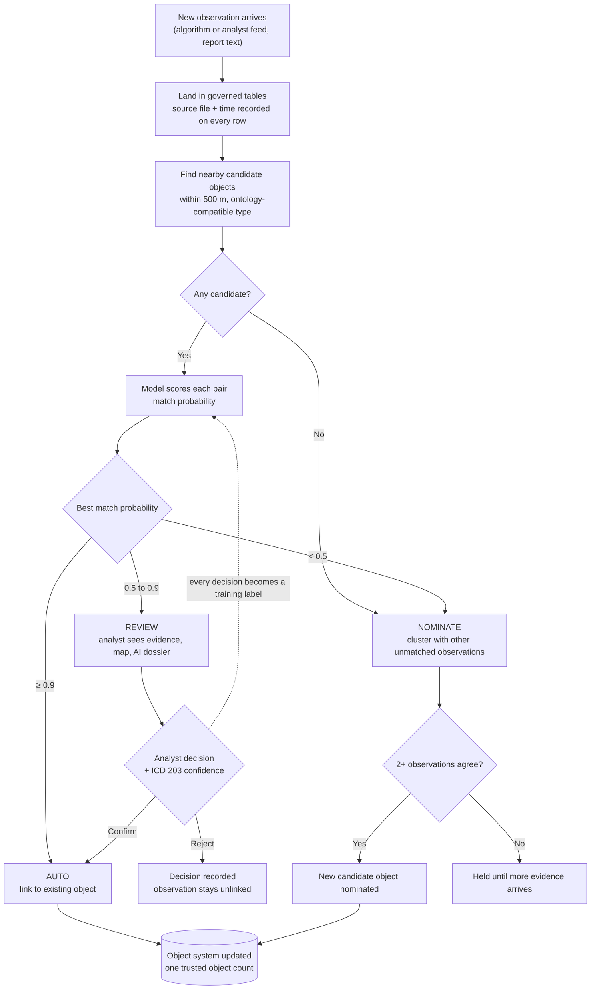

# 10-minute executive demo script

A condensed, slide-free version of `docs/plan/05-demo-script.md` for a 10-minute slot where the only visual is Databricks. The goal is to show the use case and a working proof of concept and to start a planning conversation. It is not a platform pitch. All data is synthetic. Numbers come from the pipeline run recorded in `docs/plan/02-architecture.md`.

## How to read this script

| Tag        | Meaning                                  |
| ---------- | ---------------------------------------- |
| **[SAY]**  | Spoken aloud, close to word for word     |
| **[DO]**   | An action on screen                      |
| **[NOTE]** | For you only. Context, numbers, recovery |

## Resolution workflow (from new observation to resolution)

[NOTE] The diagram is for you. Talk through it at minute 1 while Catalog Explorer is on screen. If you want it visible, paste a plain-text copy into the top markdown cell of the pipeline notebook (Databricks markdown cells do not render Mermaid).

## Before you start (5 minutes, not part of the 10)

- [ ] Re-run `notebooks/generate_data.py` within the hour. This resets the review queue and keeps the "last 72 hours" counts fresh.
- [ ] Tabs open in this order: **(1)** Catalog Explorer on `workspace.objresolution_demo`, **(2)** Genie space, **(3)** Databricks App, **(4)** pipeline notebook at the cheat card (backup).
- [ ] The SQL warehouse is running, and the app and Genie have each been loaded once.
- [ ] In the app, find the row marked **Demo case B**. The queue shows only the top 50 of 137 items, so if B is missing, plan to use the notebook form in section 10b instead.
- [ ] Hero IDs are on a sticky note: A `OBJ-01289`, B `OBJ-00443` (look-alike `OBJ-T011`), C `NOM-57872318ae`.

---

## 0:00 to 1:00. The problem

**[DO]** Start on tab 1, Catalog Explorer, with the schema's table list visible.

**[SAY]** "Every assessment depends on a shared picture of objects: facilities, equipment, and eventually events. Today, observations about those objects arrive from algorithms and from analysts, across systems that don't talk to each other. So analysts spend their time deciding whether two reports describe the same thing, every brief starts with a debate over how many objects there really are, and observations that are too incomplete to stand on their own get thrown away.

What I'll show you is a working proof of concept that does three things. It makes the obvious calls automatically. It sends the hard calls to an analyst with the evidence attached. And it turns discarded observations into new candidate objects. Everything you'll see runs on synthetic data."

**[NOTE]** Say "synthetic" here, once and plainly. Don't apologise for it.

## 1:00 to 2:30. One governed picture

**[DO]** Open `bronze_observations`, go to **Sample Data**, and scroll right to the `source_file` and `ingested_at` columns.

**[SAY]** "Four kinds of sources land here: the object management system, collection and tasking records, observation feeds, and report text. They're mocked for the demo. All of them describe one thing, the Object, and the object types follow the public Common Core Ontologies, so 'vehicle' and 'truck' relate the way the ontology says they do, not the way a spreadsheet says. Every row records which file it came from and when it arrived, so any number I show can be traced to its source."

**[NOTE]** 4,662 observations and 2,025 seeded objects. If someone asks about production: "I'd connect to the real databases rather than mock them. I haven't tested that in this environment."

## 2:30 to 4:30. The system does the routine work

**[DO]** Switch to tab 2 (Genie) and type: **`How many observations fall in each decision band?`**

**[SAY]** "Each new observation is compared with the known objects nearby, and a model trained on past analyst decisions gives each pairing a probability. That probability decides who does the work. Above 90 percent, the system links the observation automatically. Between 50 and 90, it goes to an analyst. Below 50, it isn't thrown away."

**[NOTE]** Expect AUTO 82.8%, REVIEW 2.9%, NOMINATE 14.2% (3,862 / 137 / 663). Point at REVIEW: "Analysts see about 3 percent, the genuinely uncertain middle."

**[DO]** Type: **`How many new objects were nominated, and how many observations did that recover?`**

**[SAY]** "This is the part that changes what analysts get to work with. Observations that were each too weak to use, because the type was vague or the location was rough, are grouped when they agree with each other. Here they produced 128 new candidate objects and recovered 335 observations, about 7 percent of everything we received, which would otherwise have been discarded."

**[NOTE]** Precision on synthetic data is high (AUTO 0.995) but in-sample. Only quote it if asked, and add: "That's on clean synthetic data. It shows the mechanism, not real-world accuracy." If Genie misbehaves, open the cheat card in tab 4 and read the numbers from there.

## 4:30 to 7:30. The analyst stays the decider

**[DO]** Switch to tab 3 (the app). Point at the three counters, then select the row marked **Demo case B**.

**[SAY]** "This is the analyst's screen. Here's a real close call: a generic 'vehicle' sighting between a known truck and a look-alike record a few hundred metres away. The model doesn't pretend. It rates the truck as *likely* and the other record as *roughly even chance*, in the same ICD 203 language analysts already use."

**[DO]** Point at **Why the model suggests this object** (distance, type agreement, next most likely object), then the map, then open **AI summary of the suggested object**.

**[SAY]** "The analyst sees why: distance, whether the type agrees, and the runner-up. They also get an AI-generated summary of the object that is limited to our governed records and cites every report it uses by ID. The AI explains. It never changes the data."

**[DO]** Set confidence to **Moderate** and click **Confirm: same object**.

**[SAY]** "The analyst decides and records their confidence. That decision updates the object system immediately, and it's saved as a training example, so the next version of the model learns from your analysts' judgement."

**[NOTE]** Watch for *Awaiting review* to drop by one and *Decisions made* to rise by one. *Objects* stays at 2,153 because confirming links the observation to an existing object. The count already rose from 2,025 to 2,153 when the nominations were added. Retraining is described here, not run. If the app fails, say "I keep a saved run for exactly this", then use notebook section 10b, which does the same write.

## 7:30 to 8:30. Plain-English questions for leaders

**[DO]** Back in Genie, type: **`How many unique Armored Fighting Vehicle objects were observed in the last 72 hours?`**

**[SAY]** "This is the question a brief actually starts with. It's answered in plain English from the same governed records, and the answer comes with the query behind it, so it can be checked."

**[NOTE]** Read the number off the screen. It isn't pre-recorded because it shifts with the time of the run. If there's time, also ask `Which objects may be duplicate records of the same thing?`: "It also flags objects that may have been recorded twice. It found all five duplicates I planted, and an analyst confirms them. Nothing is merged automatically."

## 8:30 to 10:00. What this means and what comes next

**[DO]** Stay on Genie, or return to the app. Don't navigate during the close.

**[SAY]** "To recap: routine matches are handled automatically, analysts spend their time on the uncertain few percent with the evidence in front of them, observations that used to be discarded become new objects, and every number traces back to a source.

This is a proof of concept. The data is synthetic, the sources are mocked, and the thresholds haven't been tuned. To make it real, we'd connect two real sources, train on your actual adjudication history, and measure accuracy and analyst time against today's baseline. I'd like to leave you with a question: **where would this make the biggest difference for your analysts, and what would you need to see before trusting it?**"

**[NOTE]** Stop talking after the question. If you're asked about authorization or accreditation levels, say "I'll confirm that from official sources and follow up in writing." Never state a level from memory. Use `docs/plan/07-objection-prep.md` for other objections.

---

## If you're running long

| At    | Cut                                                                       |
| ----- | ------------------------------------------------------------------------- |
| 2:30  | Skip the sample-data scroll; say the lineage sentence over the table list |
| 4:30  | Drop the second Genie question; say "128 new objects, 335 recovered"      |
| 7:30  | Drop the 72-hour Genie question entirely                                  |
| Never | Drop the analyst confirm. It closes the loop                              |
